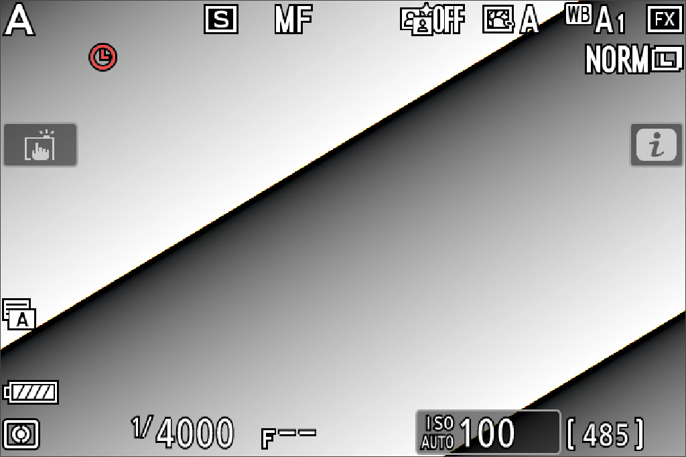
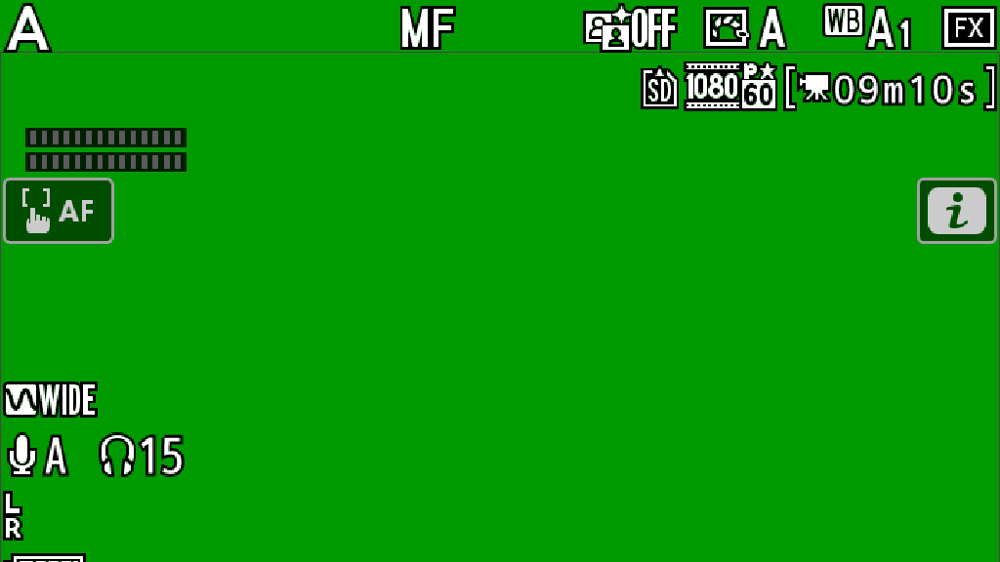

# z62-qemu

尼康 **Z6II / Z62 C1.70** 的 QEMU 系统仿真实验工程：运行原厂固件，建立机身输入、虚拟场景、软件成像、虚拟存储和可复现的观察工具。

**当前是 r49 研究快照（2026-11-02），不是完整相机模拟器，也不能证明固件可安全刷入真机。** 已有可交互的原厂菜单/近似取景及软件照片、NEF、静音录像流程；原厂拍照存卡、完整视频、镜头协议、原厂 AF 闭环和双向模式恢复仍未完成。

这是在他人公开成果上继续开发的工程。直接基础来自 [xiaoqingfeng0526/nikon-z62-qemu](https://github.com/xiaoqingfeng0526/nikon-z62-qemu)、[JKWTCN/z72-qemu](https://github.com/JKWTCN/z72-qemu)，以及 WonderLantern Z6/Z7、R3tr0ooo 等贡献者的工作。具体复用、版本与许可证见 [参考与致谢](docs/REFERENCES.md) 和 [NOTICE](NOTICE.md)。

## 当前实现到哪里

本项目使用四种标记，避免把软件替代当成原厂硬件还原：

| 标记 | 含义 |
|---|---|
| A | 原始固件指令实际执行 |
| B | 有代码/运行证据支持的设备、传输、DMA 或 IRQ 模型 |
| C | 明确标注的软件替代，如近似 ISP、镜头光学、JPEG/NEF/视频编码 |
| D | 尚未实现，或证据不足以验收 |

| 能力 | 当前状态 | 层级 / 主要边界 |
|---|---|---|
| 原厂菜单、LCD、基础按键 | 已运行，部分往返/导航通过 | A/B；受控启动，不是完整复位 ROM 启动 |
| 双段快门、拨轮、模式盘、AF-ON/Fn/录像键等 | 输入和部分应用行为已验证 | A/B；按钮到达不等于拍照、AF 或录像功能完成 |
| 原厂/候选 C1.70 加载 | 已实现同布局包检查、隔离与实际 ARM 执行 | A/B；完整固件健康和刷写安全仍未知 |
| 虚拟 RAW、有限/连续统计、近似预览 | 初始配方下可实际 DMA/处理/显示 | A/B/C；不是尼康 ISP 数学、硅片或时序的等价实现 |
| 场景、软件曝光、手动镜头效果 | 已接入原生 RAW 和原厂 LCD | C；尚未通过 Z 卡口协议驱动镜头 |
| 软件 JPEG / 实验性 NEF / 目录卡 / 回放删除 | 主要流程已有验证 | C；NEF 为 1514×1006、12 位有效源封装至 14 位，RawPy/LibRaw 独立核对 |
| 软件异步录像 | 已有编码、审计、保存、回放和取消流程 | C；640×424、H.264、VFR、无音频，未验收完整 60 秒/长稳 |
| 预览单元结果通知（r47b） | 实际输出后才产生结果 IRQ | B/C；有限配方，实验开关默认关闭 |
| 命令组 0 数值处理（r48） | 实际 RGB→packed12 后原厂自然收到完成 | A/B/C；初始配方 5/5 目标等待成功，非完整 11 算子还原 |
| 模式切换恢复（r49） | **实际验证失败** | 新命令配方未覆盖；视频 OSD 出现但无有效背景，返回未恢复取景 |
| 原厂 JPEG/NEF 编码并存入客体卡 | **未完成** | D；软件媒体目录卡与原厂 SD/DCIM 不是同一链路 |
| 完整镜头通信、原厂 AF、多帧闭环 | **未完成** | D；没有用自写 AF 冒充原厂算法 |

完整细项见 [功能清单](docs/FEATURES.md)、[详细覆盖表](docs/CAPABILITY-COVERAGE.md) 和 [已知问题](docs/LIMITATIONS.md)。

## 两条运行路线

**交互路线：r27 宿主 + r24 内核。** 提供较完整的场景、软件照片/NEF、回放和异步软件录像界面。通常从 `start-z6ii-async-video.cmd` 进入，端口 `8684`。这些媒体功能属于 C 层。

**设备研究路线：r48 内核 + r49 观察工具。** 研究实际数据写回、原厂完成回调和切换恢复。r48 不自动替换旧入口；r49 的恢复结果是失败。原有 `start-z6ii-qemu.cmd` 是机身/采集研究入口，不会自动变成完整媒体控制台。

首次克隆需要自己准备合法取得的原厂固件、固定依赖和构建环境：

```powershell
git clone --recurse-submodules https://github.com/new-Beginner/z62-qemu.git
cd z62-qemu
python -m venv .venv
.venv/Scripts/python.exe -m pip install -r requirements.txt -r requirements-raw-verify.txt -r requirements-video.txt
```

之后按 [构建和运行](docs/BUILD.md) 准备输入并构建所选路线。本仓库发布源码，不附带 Windows EXE、尼康固件或现成的本机 `.build` 缓存；仅克隆后双击旧 CMD 不能替代这些步骤。

## 最近两次实际结果

| 阶段 | 实际结果 | 不能据此推出 |
|---|---|---|
| r48 | 12.048 客体秒，34 组/136 输出；两次完整快照共 19,200 样本一致；5 次目标等待均成功 | 不能推广到视频配方、整机、实机画质或刷机安全 |
| r49 | 55.051 客体秒、39 个已知样本；初始 5 次成功、切换后 19 次超时；模式恢复失败 | 534 项回归通过不等于模式恢复通过 |

本次公开整理另在独立源码目录运行了明确的20模块子集：**98项通过，零失败/错误/跳过**；验证了源码哈希、Python编译、文档链接和软件媒体/观察器等合同。它没有重跑原厂固件或完整历史构建，见 [验证说明](docs/VALIDATION.md)。

切换后的命令值从初始配方的 **40/1002** 变为 **34/846**，LCD 从 1024×682 变为 1024×576。目前还缺新模式下完整的 RAW、统计及输出描述符；不能只放宽检查后发完成通知。详见 [技术难点](docs/TECHNICAL-CHALLENGES.md)。

<details>
<summary>实际原厂 LCD：初始取景与切换后的边界</summary>

初始照片 OSD 和合成测试图：



切换后的视频 OSD，背景尚无有效图像：



截图只作为观察证据，不能独立证明处理、存卡或恢复成功。

</details>

## 文档与开发记录

- [完整开发过程与报告索引](docs/DEVELOPMENT.md)：从早期启动、菜单、RAW/ISP、机身输入，到软件媒体和 r49；保留失败和纠正。
- [功能清单](docs/FEATURES.md)：已实现、部分实现、缺失与证据不足。
- [技术难点](docs/TECHNICAL-CHALLENGES.md)：数据合同、停止/重启、镜头/AF、固件完整性和验证边界。
- [构建和运行](docs/BUILD.md)：依赖、固定上游、固件输入、构建顺序及入口区别。
- [验证与公开证据](docs/VALIDATION.md)：本地完整测试、可独立运行的源码检查、运行验证与未通过项。
- [参考与致谢](docs/REFERENCES.md)：直接基础、参考研究、工具和许可证。
- [原始证据索引](docs/evidence-index.json) 与 [公开文件溯源](publication-manifest.json)：原始/公开副本的 SHA 和隐私处理。

历史报告按阶段归档；旧报告中的“已实现/未完成”只对当时版本成立。省略的大型原始轨迹和本地材料会标为“本地证据，未分发”，不会伪装成可下载文件。

## 使用边界与许可证

仅用于本地离线研究。虚拟 SD 只接受普通镜像文件；本工程不连接相机、不刷写、不把模拟通过当作实机更新安全认证。更新包不等于完整机身 ROM，个体 NOR/标定、断电更新恢复、真实电气时序仍有缺口。

本项目自己的设备扩展、工具和文档采用 **GPL-2.0-or-later**，除非文件另有说明。第三方按原许可证保留；Nikon 固件和 Tornado NKN 不在该授权范围内。见 [COPYING](COPYING)、[NOTICE](NOTICE.md) 与 [第三方说明](docs/REFERENCES.md)。
